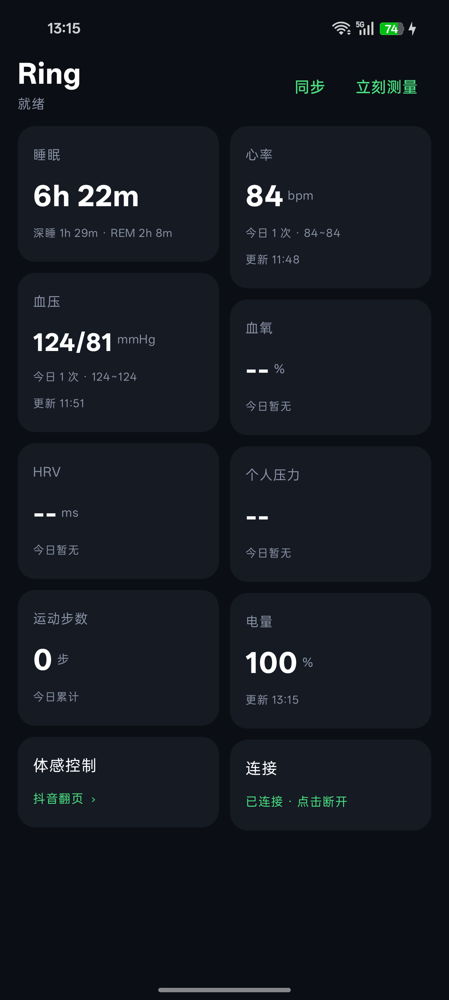
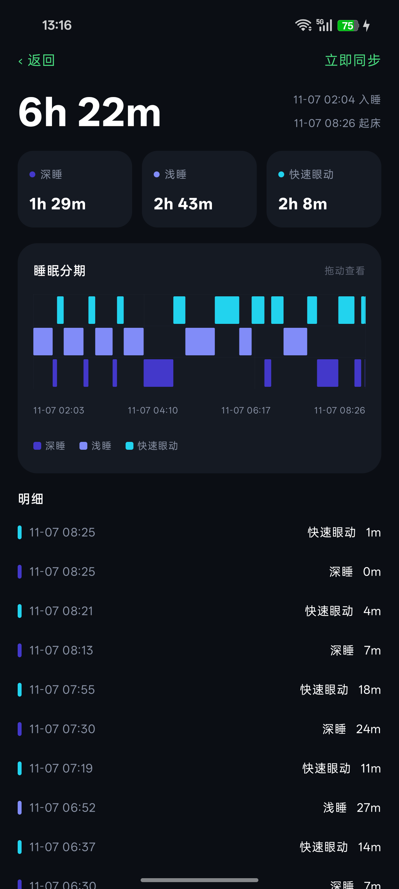
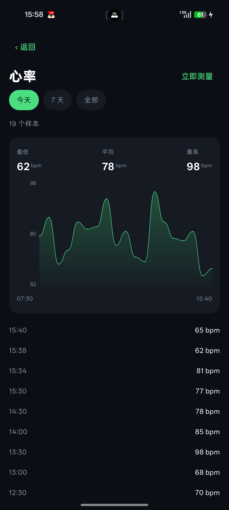

# Ring — 智能戒指客户端 (Android)

一个为某品牌智能戒指重写的轻量 Android 客户端。原厂 App 体积臃肿、广告多、数据展示混乱，本项目通过逆向其 BLE 协议，实现了一个**数据准确、界面简洁、功能完整**的替代客户端。

> 仅用于本人自有设备的学习与研究，不涉及破解他人账号、不绕过付费功能、不分发修改后的原厂应用。

---

## 功能

| 模块 | 说明 |
|---|---|
| 睡眠 | 每晚分期：深睡 / 浅睡 / 快速眼动，连续色带 + 时间轴，可拖动查看 |
| 心率 | 实时 + 历史曲线，今日次数与区间 |
| 血压 | 收缩压 / 舒张压双曲线 |
| 血氧 | 定时测量 + 历史 |
| HRV | 心率变异性历史曲线 |
| 个人压力 | 由 HRV 推算（`stress = 90 - HRV × 0.75`，限幅 5~95） |
| 运动步数 | 今日累计 + 实时步数 |
| 电量 | 电量百分比与固件版本 |
| 体感控制 | 摇晃戒指 → 抖音翻页 / 遥控拍照（无障碍手势），自动上膛 + 事件应答 |
| 自动同步 | 连接后自动拉取全部历史；每 30 分钟自动测量一轮，卡死自恢复 |
| 设备校时 | 连接即下发 `0x0100` 时间校准，保证历史记录时间戳有效 |

## 截图

| 首页 | 睡眠分期 | 心率曲线 |
|---|---|---|
|  |  |  |

## 技术栈

- Kotlin + Jetpack Compose（Material 3，深色主题）
- 原生 BLE（`BluetoothGatt`），自建串行操作队列，避免 GATT 忙冲突
- SQLite（`SQLiteOpenHelper`）本地存储，`(metric, ts)` 唯一索引去重
- 前台服务保持连接；无障碍服务实现手势注入
- 瀑布流卡片（`LazyVerticalStaggeredGrid`）

## 目录结构

```
app/src/main/java/com/rea/ring/
├── Protocol.kt                 帧封装 / CRC16 / hex 工具
├── Ring.kt                     BLE 核心：扫描、连接、收发、解析、测量调度
├── Store.kt                    本地数据库（样本 + 睡眠分段）
├── MainActivity.kt             首页（卡片、统计）
├── DetailActivity.kt           详情页（曲线、时间范围、拖动取值）
├── RingService.kt              前台服务
├── SwipeService.kt             无障碍服务：上滑 / 点快门
├── GesturePrefs.kt             体感模式持久化（关 / 翻页 / 拍照）
└── GestureToggleReceiver.kt    广播开关（可被侧键模块调用）
```

## 构建

**环境**：JDK 17+、Android SDK 35、Gradle 8.7+

```bash
# 1) 指定 SDK 路径
echo "sdk.dir=/path/to/Android/sdk" > local.properties

# 2A) 用 Android Studio 直接打开本目录，点 Run
# 2B) 或命令行构建
gradle assembleDebug
```

产物：`app/build/outputs/apk/debug/app-debug.apk`

> 仓库未内置 Gradle Wrapper，如需可先执行 `gradle wrapper` 生成。

## 权限

| 权限 | 用途 |
|---|---|
| `BLUETOOTH_SCAN` / `BLUETOOTH_CONNECT` | 扫描与连接戒指 |
| `POST_NOTIFICATIONS` | 前台服务通知 |
| `FOREGROUND_SERVICE_CONNECTED_DEVICE` | 保持后台连接 |
| 无障碍服务（手动开启） | 翻页手势 / 点击相机快门 |

## 协议摘要

设备通过自定义 GATT 服务通信：

```
Service  be940000-7333-be46-b7ae-689e71722bd5
  C1     be940001  write + indicate   命令通道（有应答）
  C2     be940002  write (no resp)    批量数据
  C3     be940003  indicate           实时数据流
```

帧格式：

```
[type_hi][type_lo][len_lo][len_hi][payload...][crc_lo][crc_hi]
  len = payload 长度 + 6
  CRC = CRC16-CCITT (init 0xFFFF, 非反射)，小端写入
```

常用命令：

| 命令 | 载荷 | 说明 |
|---|---|---|
| `0x0200` | `47 43` | 读设备信息（电量、固件版本） |
| `0x032F` | `[1,type]` | 开始测量：0=心率 1=血压 2=血氧 4=体温 10=HRV 12=压力 |
| `0x0309` | `[1,0,2]` | 请求实时运动数据 |
| `0x030E` | `[01]` | 进入拍照待命（戒指开始上报摇晃事件） |
| `0x0504` | — | 同步睡眠 |
| `0x0506` | — | 同步心率历史 |
| `0x0508` | — | 同步血压历史 |
| `0x0509` | — | 同步全部历史 |

数据类型（设备 → App）：

| 类型 | 含义 | 载荷 |
|---|---|---|
| `0x0600` | 运动 | 步数(2) 距离(2) 卡路里(2) |
| `0x0601` | 心率 | 1 字节 |
| `0x0602` | 血氧 | 1 字节 |
| `0x0603` | 血压 | 收缩(1) 舒张(1) 心率(1) |
| `0x0518` | 混合历史 | 20 字节/条 |
| `0x0513` | 睡眠分段 | 8 字节/条 |
| `0x0403` | 戒指摇晃事件 | 1 字节 |

### 混合历史记录（0x0518，20 字节）

```
0-3   timestamp (LE, +946684800 = Unix 秒，再减时区偏移)
4-5   步数
6     心率
7     收缩压
8     舒张压
9     血氧
10    呼吸率
11    HRV
12    CVRR
13-14 体温（整数 + 小数）
15-17 体脂 / 血糖
```

### 睡眠分段（0x0513，8 字节）

```
0-1   时长（秒，LE）
2     保留 0x00
3     类型：0xF1 浅睡 / 0xF2 快速眼动 / 0xF3 深睡
4-7   该段时间戳（是"这一段的结束时刻"，起始 = ts - 时长）
```

## 更新日志

### v1.1.0 — 2026-11-09

**修复**

- 全量测量互斥锁死锁：中途断连会让 `measuring` 永远为 `true`，之后所有自动测量被静默丢弃。
  改为 6 分钟超时 + 240 秒兜底复位。
- 戒指 RTC 丢失导致历史记录时间戳为 0（2000-01-01），历史全部被过滤。
  新增连接时自动下发 `0x0100` 校时（原厂 App 同样动作，已验证设备接受）。
- 历史帧 `0x0518` 解析错位：分片长度不是 20 的整数倍时记录会整体偏移。
  改为「打分对齐」——遍历 20 种偏移，取时间戳最连续、最合理的一种。
- 睡眠同步偶发无响应：改为 25 秒重试，最多 3 次，并在设备回 0 条时给出状态提示。
- 体感控制失效：设备在收到 `0x0403` 摇一摇事件后需要 App 回一帧确认。
  已补上应答，并按原厂逻辑定期下发 `0x030E [01]` 保持待命。

**新增**

- 体温卡片（本机型硬件不支持体温传感器，能力位与命令返回均为否定，卡片如实提示）。
- HRV / 压力数据超过 2 小时会显示「数据较旧」提示。

**已知限制**

- 实时血压帧 `0x0603` 中的 HRV 字节恒为 0，HRV 仅来自设备历史记录。
- 体温传感器能力位 `bArr[8] & 1 = 0`，`0x0318` 返回 `0xFC`（不支持）。

## 免责声明

- 本项目与任何厂商无关，未获其授权。
- 所有协议信息来自对**本人自有设备**的抓包与静态分析，仅用于互操作研究。
- 请勿将本项目用于商业用途或分发修改后的原厂应用。
- 使用本客户端造成的数据差异由使用者自行承担。

## License

[MIT](LICENSE)